# Predicción de Abandono de Clientes — Telco Customer Churn

**MLY1101 Machine Learning · Caso A · Evaluación Parcial N°2**
Instituto Profesional Duoc UC · Escuela de Informática y Telecomunicaciones · Sede Plaza Norte

**Integrantes:** Abraham Alejandro Abanto Sánchez · Bastián Isaías Soto González · Andrés Vicente Silva Díaz
**Docente:** Víctor Andrés Trigo Rojas

Informe técnico del proyecto. Documenta el desarrollo completo, desde el problema de negocio hasta los modelos y su evaluación, y cómo reproducirlo. Cada resultado citado aquí sale de los notebooks de `notebooks/`.

---

## Índice

1. [Descripción del problema de negocio](#1-descripción-del-problema-de-negocio)
2. [Objetivos del proyecto](#2-objetivos-del-proyecto)
3. [Definición de KPIs](#3-definición-de-kpis-que-resolverán-el-problema-de-negocio)
4. [Descripción de las fuentes de datos](#4-descripción-de-las-fuentes-de-datos-utilizadas)
5. [Preparación y análisis exploratorio de los datos (EDA)](#5-preparación-y-análisis-exploratorio-de-los-datos-eda)
6. [Metodología utilizada (CRISP-DM)](#6-metodología-utilizada-crisp-dm)
7. [Evaluación de sesgos, ética y privacidad](#7-evaluación-de-sesgos-ética-y-privacidad)
8. [Conclusiones y recomendaciones](#8-conclusiones-y-recomendaciones)
9. [Estructura del proyecto](#9-estructura-del-proyecto)
10. [Cómo reproducir el proyecto](#10-cómo-reproducir-el-proyecto)
11. [Referencias](#11-referencias)

---

## 1. Descripción del problema de negocio

Una empresa de telecomunicaciones que ofrece telefonía fija e Internet pierde clientes que dan de baja el servicio (**churn**). Cada baja significa perder un ingreso recurrente mensual y también la inversión que costó captar a ese cliente.

**Contexto de la industria.** El mercado de telecomunicaciones es muy competitivo, los servicios son cada vez más parecidos entre empresas y cambiarse de compañía es fácil y barato para el cliente. Por eso la fidelización no depende solo del precio. También depende de la calidad del servicio, de la atención y de la capacidad de la empresa de **anticiparse** antes de que el cliente decida irse.

**Consecuencias del abandono:**
- Pérdida directa del ingreso mensual de los servicios contratados.
- Pérdida del costo de adquisición (CAC) invertido en el cliente, que no alcanza a recuperarse si el cliente se va antes de lo esperado.
- Efecto reputacional: un cliente insatisfecho comparte su mala experiencia.
- Presión sobre el área comercial, que debe invertir más en captar clientes nuevos solo para mantener la base.

**Problema a resolver:** identificar, con los datos demográficos, de servicios y de facturación de cada cliente, **qué clientes tienen mayor probabilidad de abandonar**, para que el área comercial pase de una retención **reactiva** (actuar cuando el cliente ya pidió la baja) a una **proactiva** (contactarlo antes con una oferta adecuada a su perfil).

**Alcance de esta entrega (EP2):** incluye todo lo de la EP1, corregido con la retroalimentación del docente (comprensión del negocio, EDA y preparación), más la construcción y comparación de **dos modelos supervisados** de clasificación, **una técnica no supervisada** de segmentación y la **evaluación** de resultados con métricas y KPIs de negocio.

## 2. Objetivos del proyecto

**Objetivo general:** construir una solución de Machine Learning que estime la probabilidad de abandono de cada cliente y permita priorizar y personalizar campañas de retención.

**Objetivos específicos:**
1. Comprender el negocio y los factores asociados al abandono de clientes.
2. Evaluar el origen y la calidad de los datos y explorarlos (EDA) con métricas y pruebas estadísticas.
3. Preparar y transformar los datos para el modelamiento sin filtrar información del conjunto de prueba.
4. Implementar y comparar dos modelos supervisados de clasificación (Regresión Logística y Random Forest), justificando el algoritmo y su configuración.
5. Aplicar una técnica no supervisada (K-Means) para descubrir segmentos de clientes útiles para diseñar campañas.
6. Evaluar los modelos con métricas adecuadas a datos desbalanceados y traducirlas en KPIs y recomendaciones de negocio.
7. Evaluar los sesgos, la ética y la privacidad del uso de los datos y del modelo.

## 3. Definición de KPIs que resolverán el problema de negocio

| KPI | Definición | Resultado obtenido (conjunto de prueba) |
|---|---|---|
| **Tasa de churn (%)** | Clientes que abandonan / total de clientes. Mide el tamaño del problema. | 26,5% (1.869 de 7.043 clientes) |
| **Recall (sensibilidad)** | De los clientes que efectivamente se van, % que el modelo detecta a tiempo. **KPI más crítico**: un abandono no detectado es un cliente perdido sin oportunidad de retención. Meta: ≥ 80%. | **78,9%** (295 de 374) |
| **Precisión** | De los clientes marcados como riesgo, % que efectivamente se va. Controla el gasto en contactar a clientes que no se iban a ir. | 50,3% |
| **Costo evitado (ingreso protegible)** | Ingreso mensual de los clientes que se van y que el modelo identifica, sobre el ingreso mensual total en riesgo. | **82,8%** (USD 22.542 de USD 27.215 mensuales) contactando al 41,7% de los clientes |

Métricas técnicas de apoyo: F1 (equilibrio entre recall y precisión), ROC-AUC y PR-AUC (capacidad de ordenar a los clientes por riesgo, independiente del umbral).

## 4. Descripción de las fuentes de datos utilizadas

### 4.1 Origen

| Pregunta | Respuesta |
|---|---|
| ¿Quién publica los datos? | **IBM**, como *dataset* de muestra del producto **IBM Cognos Analytics** (versión 11.1.3+), publicado por el equipo *Samples Team* de IBM el 11-07-2019. |
| ¿Qué empresa? | Una **compañía de telecomunicaciones ficticia**: son datos de muestra creados para demostración; IBM no nombra una empresa real. |
| ¿Qué país? | **Estados Unidos, estado de California.** |
| ¿Qué período? | Un trimestre fiscal (**Q3**). IBM **no informa el año**. |
| ¿Qué contiene? | 7.043 clientes con servicios de telefonía fija e Internet. |
| ¿De dónde se obtuvo? | Kaggle, *Telco Customer Churn* (usuario *blastchar*), versión de 21 columnas. Archivo del proyecto: `data/Telco_Customer_Churn_Dataset.csv` (mismo contenido que el usado en la EP1). |

Cita de IBM: *"a fictional telco company that provided home phone and Internet services to 7043 customers in California in Q3"*.

### 4.2 Diccionario de variables (7.043 filas × 21 columnas)

| Grupo | Variables |
|---|---|
| Identificador | `customerID` (código anónimo; no se usa para modelar) |
| Demográficas | `gender` (Female/Male), `SeniorCitizen` (0/1, 65 años o más), `Partner` (tiene pareja), `Dependents` (tiene dependientes) |
| Servicios | `PhoneService`, `MultipleLines`, `InternetService` (DSL / Fiber optic / No), `OnlineSecurity`, `OnlineBackup`, `DeviceProtection`, `TechSupport`, `StreamingTV`, `StreamingMovies` |
| Cuenta y facturación | `tenure` (meses como cliente, 0–72), `Contract` (Month-to-month / One year / Two year), `PaperlessBilling`, `PaymentMethod` (4 métodos), `MonthlyCharges` (cargo mensual, USD), `TotalCharges` (cargo total acumulado, USD) |
| Objetivo | `Churn` (Yes/No): si el cliente abandonó |

### 4.3 Antecedentes: quién ha modelado estos datos y qué concluyó

| Estudio | Modelos | Resultado reportado | Conclusión |
|---|---|---|---|
| Zhu (2023), ICFIED 2023, Atlantis Press | LightGBM, Regresión Logística, Random Forest | Reg. Logística: recall 0,84, F1 0,65, AUC 78%. Random Forest: accuracy 0,79 pero recall 0,46 | La Regresión Logística es la más adecuada para detectar a quienes se van; la accuracy sola engaña por el desbalance. |
| Aryani y Pratama (2026), JSI, vol. 13(2) | Regresión Logística, SVM | Accuracy 80,70% (RL) vs 79,28% (SVM) | La Regresión Logística es más estable; las variables más influyentes son tenure, MonthlyCharges, tipo de contrato y tipo de internet. |
| Wanda (2024), tesis MSc, Strathmore University | RL, Naive Bayes, KNN, Random Forest, CatBoost | Reg. Logística: recall 80% | Se eligió la Regresión Logística por su recall, y sus coeficientes se usaron para sugerir acciones. |

**Qué se tomó de estos antecedentes:** el recall como KPI principal en vez de la accuracy, la Regresión Logística como modelo de referencia interpretable y una lista de variables clave para contrastar con el EDA propio.

### 4.4 Herramientas colaborativas

| Herramienta | Uso en el proyecto |
|---|---|
| **Git / GitHub** | Control de versiones del repositorio del equipo. Cada integrante trabaja en su parte y sube sus cambios con *commits* identificados, y el historial deja registro de quién hizo qué. Repositorio: *https://github.com/Abraham1439/Telco_EP2* |
| **Jupyter Notebook** | Entorno reproducible: el código, los resultados y su explicación quedan juntos y cualquiera puede volver a ejecutarlos. |
| **Python** (pandas, scikit-learn, SciPy, matplotlib) | Manipulación de datos, pruebas estadísticas, modelos y gráficos. |

## 5. Preparación y análisis exploratorio de los datos (EDA)

Detalle completo, con código y salidas, en [`notebooks/01_EDA_Preparacion_Churn.ipynb`](notebooks/01_EDA_Preparacion_Churn.ipynb).

### 5.1 Calidad de los datos

| Revisión | Resultado | Acción |
|---|---|---|
| Valores nulos | 0 | — |
| Valores en blanco | 11 en `TotalCharges`, todos de clientes con `tenure = 0` (recién ingresados, ninguno abandonó) | Convertir a numérico e imputar **0**: aún no tienen facturación acumulada. Imputar la media inventaría una facturación que no existe. |
| Duplicados | 0 filas duplicadas y 0 `customerID` repetidos | — |
| Valores atípicos (regla 1,5 × IQR) | 0 en `tenure`, `MonthlyCharges` y `TotalCharges` | Se conservan todos los registros |
| Consistencia entre columnas | 100%: quien no tiene teléfono figura como "No phone service" y quien no tiene internet figura como "No internet service" en los 6 servicios asociados | Permite eliminar columnas duplicadas (5.4) |
| `TotalCharges` ≈ `tenure` × `MonthlyCharges` | Mediana de desviación 0%. 59 clientes con diferencia > ±20%, interpretados como cambios de plan | Se mantienen. `TotalCharges` es redundante con `tenure`. |

### 5.2 Variable objetivo

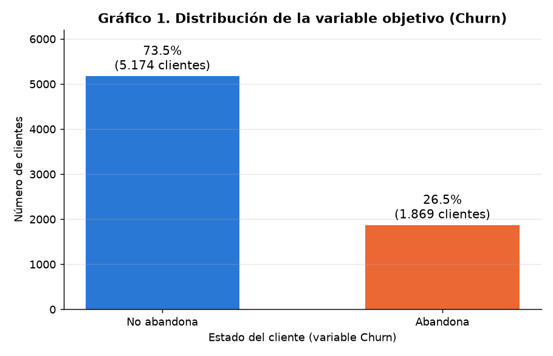

**26,5%** de los clientes abandona (1.869) y 73,5% se queda (5.174): un desbalance de 1 : 2,8. Un modelo que siempre prediga "no abandona" tendría 73,5% de accuracy con 0% de recall, por eso se evalúa con recall, precisión, F1 y PR-AUC.

### 5.3 Variables numéricas vs. Churn (respaldo con métricas)

Ninguna variable numérica es normal (prueba de D'Agostino, p ≈ 0). Por eso las diferencias se prueban con **Mann-Whitney U** (no paramétrica) y se mide el tamaño del efecto con la correlación rango-biserial (r).

| Variable | Grupo | Media | Mediana | Moda | Desv. est. | Mann-Whitney | Efecto r |
|---|---|---|---|---|---|---|---|
| `tenure` (meses) | No abandona | 37,57 | 38 | 72 | 24,11 | p = 2,4e-208 | −0,48 |
| | Abandona | 17,98 | **10** | **1** | 19,53 | | |
| `MonthlyCharges` (USD) | No abandona | 61,27 | 64,43 | 20,05 | 31,09 | p = 3,3e-54 | 0,24 |
| | Abandona | 74,44 | **79,65** | 74,40 | 24,67 | | |
| `TotalCharges` (USD) | No abandona | 2.549,91 | 1.679,52 | 0 | 2.329,95 | p = 5,7e-83 | −0,30 |
| | Abandona | 1.531,80 | 703,55 | 20,20 | 1.890,82 | | |

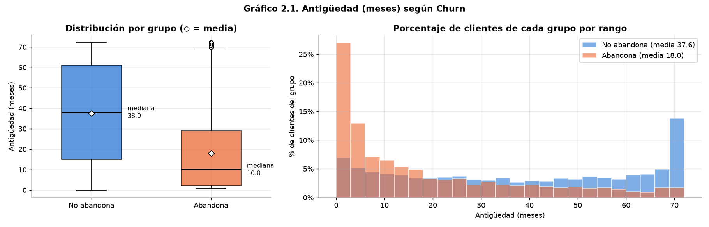

- Quienes abandonan llevan una **mediana de 10 meses** como clientes, contra 38 meses de quienes se quedan, y la moda de quienes se van es **1 mes**. El efecto es mediano-grande.
- Quienes abandonan pagan una **mediana de USD 79,65**, contra USD 64,43 de quienes se quedan. El efecto es pequeño-mediano y **no es lineal** (ver 5.6).

### 5.4 Variables categóricas vs. Churn

Hay un gráfico por variable, con la tasa de churn de cada categoría, el número de clientes y la tasa global como referencia (gráficos 3.1 a 3.8 en `images/`). Para medir la asociación de cada variable categórica con el churn se usa la **V de Cramér**, con prueba chi-cuadrado:

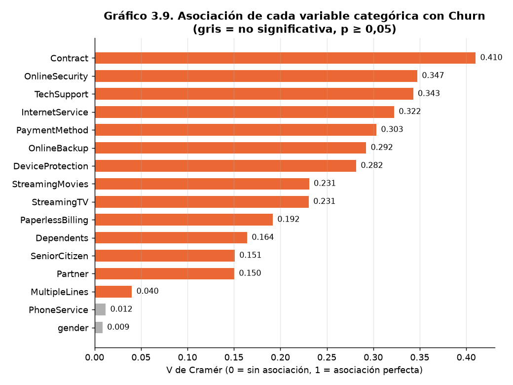

| Variable | Tasa de churn por categoría | V de Cramér |
|---|---|---|
| Contrato | Mes a mes **42,7%** · Un año 11,3% · Dos años **2,8%** | **0,410** |
| Seguridad online | No 41,8% · Sí 14,6% · Sin internet 7,4% | 0,347 |
| Soporte técnico | No 41,6% · Sí 15,2% · Sin internet 7,4% | 0,343 |
| Internet | Fibra óptica **41,9%** · DSL 19,0% · Sin internet 7,4% | 0,322 |
| Método de pago | Cheque electrónico **45,3%** · Cheque por correo 19,1% · Transferencia 16,7% · Tarjeta 15,2% | 0,303 |
| Adulto mayor | Sí 41,7% · No 23,6% | 0,151 |
| Género | Mujer 26,9% · Hombre 26,2% | **0,009 (p = 0,49, no significativa)** |

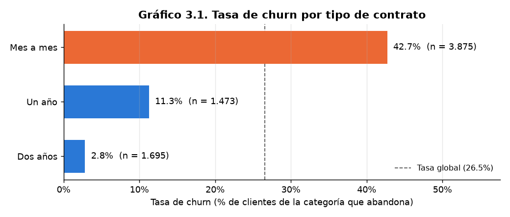

### 5.5 Correlación (coeficiente adecuado a cada tipo de variable)

| Par de variables | Coeficiente | Justificación |
|---|---|---|
| Numérica – numérica | **Spearman** | Las variables no son normales; Spearman mide relaciones monótonas sin suponer normalidad ni linealidad. |
| Numérica – Churn (binaria) | **Punto-biserial** (+ Spearman como respaldo) | Es la correlación específica para una variable dicotómica. |
| Categórica – Churn | **V de Cramér** | Las dos variables son nominales. |

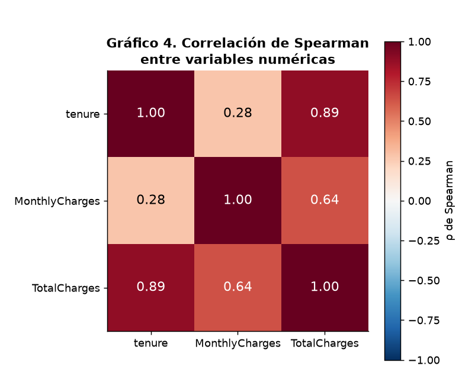

- `tenure` y `TotalCharges` tienen ρ = **0,89**: son casi redundantes.
- Correlación con Churn: `tenure` −0,35 (punto-biserial) / −0,37 (Spearman); `MonthlyCharges` 0,19 / 0,18; `TotalCharges` −0,20 / −0,23. Todas significativas (p < 0,001).

### 5.6 Primer vs. último decil

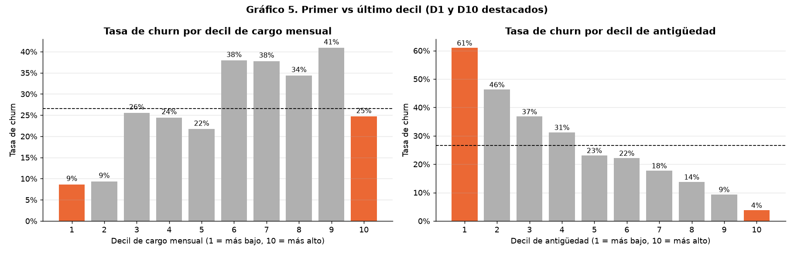

| Variable de corte | D1 (decil más bajo) | D10 (decil más alto) |
|---|---|---|
| Antigüedad | 0–2 meses: **61,0% churn**, 96,7% mes a mes | 69–72 meses: **3,8% churn**, 2,0% mes a mes |
| Cargo mensual | USD 18–20: 8,7% churn, 3,3% adultos mayores | USD 103–119: 24,7% churn, **25,0% adultos mayores**, 100% fibra |

- La antigüedad tiene una relación **monótona**: el riesgo cae decil a decil.
- El cargo mensual **no tiene una relación lineal**. El churn máximo, entre 34% y 41%, está en los deciles 6 a 9 (USD 70–103), y baja en el D10 porque los clientes que más pagan suelen tener contratos largos: solo 29,5% del D10 es mes a mes. Es decir, "pagar más" se asocia a abandonar solo cuando va junto con un contrato mes a mes.
- Los adultos mayores se concentran en los planes caros. Esto se retoma en la evaluación de sesgos.

### 5.7 Transformación de los datos

| Paso | Detalle |
|---|---|
| Corrección de tipo | `TotalCharges` a numérico; 11 blancos imputados con 0 |
| Eliminación | `customerID` (sin valor predictivo) |
| Codificación binaria | Yes/No → 1/0 y Female/Male → 1/0, con un mapeo explícito |
| One-hot encoding | 10 variables multinivel con `drop_first=True` |
| **Eliminación de redundancias** | 7 columnas (`<servicio>_No internet service` y `MultipleLines_No phone service`), que son idénticas a `InternetService_No` y a `PhoneService`. Se verificó con `assert` antes de eliminarlas. Evita la multicolinealidad perfecta. Resultado: 23 variables predictoras más `Churn`. |
| **Escalado según la forma de la distribución** | `tenure` (skew 0,24, curtosis −1,39, acotada y aplanada) → **MinMaxScaler** · `MonthlyCharges` (skew −0,22, curtosis −1,26, bimodal y acotada) → **MinMaxScaler** · `TotalCharges` (skew **0,96**, asimétrica a la derecha) → **RobustScaler** (usa mediana e IQR). StandardScaler no corresponde porque ninguna variable es normal. |
| **Partición sin fuga de información** | 80% train (5.634) / 20% test (1.409), estratificada (26,5% de churn en ambos). El escalado se ajusta **solo con train**, dentro de un `Pipeline`. |
| Salida | `data/telco_churn_limpio.csv`: limpio y codificado, sin escalar. El escalado se aplica dentro de cada modelo. |

**Correcciones respecto a la EP1:** en la EP1 se usó StandardScaler para todas las variables y se ajustó con el dataset completo **antes** de dividir en train y test (fuga de información). Además, se mantenían las 7 columnas redundantes. Las tres cosas quedaron corregidas.

## 6. Metodología utilizada (CRISP-DM)

### 6.1 Fases

| Fase CRISP-DM | Qué se hizo | Dónde |
|---|---|---|
| 1. Comprensión del negocio | Problema, objetivos y KPIs | §1–3 · notebook 1 §3 |
| 2. Comprensión de los datos | Origen, antecedentes, calidad, consistencia, EDA con pruebas estadísticas, correlación adecuada y deciles | §4–5 · notebook 1 §2, §4, §5 |
| 3. Preparación de los datos | Limpieza, codificación, eliminación de redundancias, escalado justificado, partición sin fuga y selección ética de variables | §5.7, §6.2 · notebook 1 §6 · notebook 2 §3 |
| 4. Modelamiento | Línea base, Regresión Logística, Random Forest y K-Means | §6.2, §6.4 · notebook 2 §4, §5, §9 |
| 5. Evaluación | Validación cruzada, test, umbral, KPI de negocio, interpretación y auditoría de sesgo | §6.3, §7 · notebook 2 §6–8 |
| 6. Despliegue | Propuesta de puesta en producción y monitoreo | §6.5 |

Detalle de modelamiento y evaluación en [`notebooks/02_Modelamiento_Churn.ipynb`](notebooks/02_Modelamiento_Churn.ipynb).

### 6.2 Modelamiento supervisado (clasificación)

**Selección de variables.** Se probó con validación cruzada (solo train) si quitar `gender` y `SeniorCitizen` empeoraba los modelos. No los empeora: el F1 de la Regresión Logística se mantiene en 0,629 y el del Random Forest pasa de 0,635 a 0,633. Por eso se entrenó **sin** esas dos variables (21 predictoras), y se guardaron solo para auditar sesgos.

**Línea base.** Predecir siempre "no abandona" da accuracy 0,735, recall 0 y PR-AUC 0,265. Es el piso que los modelos deben superar.

| | Modelo 1: Regresión Logística | Modelo 2: Random Forest |
|---|---|---|
| **Por qué** | Entrega una probabilidad y coeficientes interpretables (*odds ratio*) para explicar el riesgo de cada cliente; es el modelo con mejor recall en los antecedentes | Captura no linealidades e interacciones sin especificarlas (p. ej. cargo alto × contrato mes a mes, vista en los deciles); es un ensamble que reduce la varianza de un árbol individual |
| **Desbalance** | `class_weight="balanced"` | `class_weight="balanced"` |
| **Escalado** | Necesario (MinMax / Robust en el Pipeline) | No lo necesita; se mantiene el mismo Pipeline para comparar en igualdad de condiciones |
| **Hiperparámetros buscados** | `C` ∈ {0,01; 0,1; 1; 10}, `penalty` ∈ {l1, l2} | `max_depth` ∈ {None, 6, 10}, `min_samples_leaf` ∈ {1, 5, 10, 20}, `max_features` ∈ {sqrt, 0,5}; 300 árboles |
| **Búsqueda** | GridSearchCV, 5 particiones estratificadas, criterio F1 | Ídem |
| **Mejor configuración** | `C = 1`, `penalty = l1` | `max_depth = 10`, `min_samples_leaf = 10`, `max_features = 0,5` |

**Control del sobreajuste (Random Forest):** con `min_samples_leaf = 1` el F1 es 0,809 en train y 0,629 en validación (brecha de 0,18). Con `min_samples_leaf = 10` queda en 0,708 en train y 0,637 en validación (brecha de 0,07), y es la mejor configuración en validación.

### 6.3 Evaluación

**Validación cruzada (5 particiones de train, media ± desviación):**

| Modelo | Recall | Precisión | F1 | ROC-AUC | PR-AUC |
|---|---|---|---|---|---|
| Regresión Logística | **0,803 ± 0,039** | 0,520 ± 0,019 | 0,631 ± 0,024 | 0,846 ± 0,013 | 0,660 ± 0,021 |
| Random Forest | 0,775 ± 0,021 | **0,541 ± 0,015** | 0,637 ± 0,016 | 0,845 ± 0,012 | 0,664 ± 0,020 |

**Conjunto de prueba (1.409 clientes no vistos, umbral 0,5):**

| Modelo | Accuracy | Recall | Precisión | F1 | ROC-AUC | PR-AUC |
|---|---|---|---|---|---|---|
| Línea base | 0,735 | 0,000 | 0,000 | 0,000 | 0,500 | 0,265 |
| Regresión Logística | 0,737 | 0,789 | 0,503 | 0,614 | 0,841 | 0,634 |
| Random Forest | 0,761 | 0,789 | 0,533 | 0,636 | 0,843 | 0,649 |

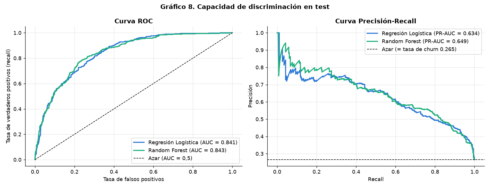

**Elección del modelo final: Regresión Logística.**
- El criterio se fijó **antes** de mirar test: gana el mayor PR-AUC en validación cruzada, y si la diferencia es menor que la desviación entre particiones, se considera empate y gana el modelo más interpretable.
- La diferencia fue 0,0045 frente a una desviación de 0,0205, es decir, un empate técnico.
- **Costo de esta decisión:** en test, el Random Forest detectó a los mismos 295 clientes con 34 falsas alarmas menos (258 vs 292). No se cambia la elección por ese resultado, porque elegir con el test haría optimista el desempeño reportado. El Random Forest queda guardado como alternativa para el piloto.

**Umbral de decisión.** Se eligió con predicciones fuera de muestra sobre train, sin usar test. La regla de negocio fue tomar el umbral más alto que detecte al menos 80% de los clientes que se van, y resultó **0,50** (recall fuera de muestra 0,803).
- En test, con ese umbral, el modelo detecta **295 de 374** clientes que se van (78,9%), genera 292 falsas alarmas, deja 79 sin detectar y pide contactar a **587 de 1.409** clientes (41,7%).
- Si se necesita asegurar el 80%, la alternativa es un umbral de 0,45: recall 0,829 en test, contactando a 642 clientes.

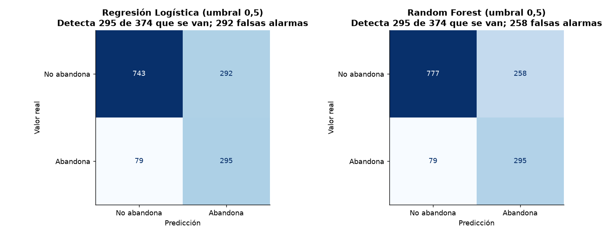

**KPI de negocio (costo evitado):** el modelo identifica a los clientes que concentran **USD 22.542 de los USD 27.215 mensuales en riesgo (82,8%)**. Como escenario ilustrativo, con supuestos explícitos que no vienen del dataset (USD 10 por contacto, 12 meses de permanencia), el beneficio neto anual sería positivo incluso con 10% de éxito de la campaña (USD 21.180). La tasa de éxito real debe medirse con un piloto.

**Capacidad de priorizar:** en el decil de mayor riesgo predicho abandona el **74,5%** de los clientes (*lift* ×2,8), contra 1,4% en el de menor riesgo. El **20% de clientes de mayor riesgo concentra el 50% de los abandonos**.

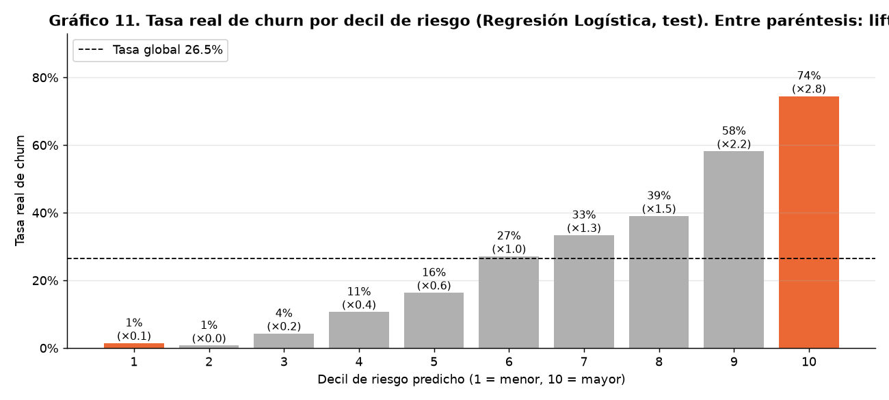

**Interpretación (variables más influyentes):**

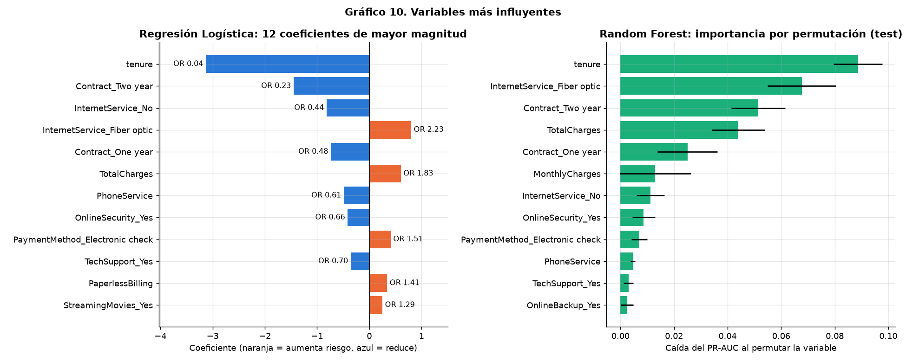

| Variable | Regresión Logística (*odds ratio*) | Lectura |
|---|---|---|
| `tenure` | OR 0,04 (de 0 a 72 meses) | La variable más importante en ambos modelos: el riesgo cae fuertemente con la antigüedad |
| Contrato dos años / un año | OR 0,23 / 0,48 (vs mes a mes) | La palanca más fuerte que la empresa controla |
| Fibra óptica | OR 2,23 | Más del doble de *odds* que DSL |
| Cheque electrónico | OR 1,51 | Más riesgo que los pagos automáticos |
| Facturación electrónica | OR 1,41 | |
| Seguridad online / soporte técnico | OR 0,66 / 0,70 | Los servicios de protección retienen |
| `TotalCharges` | OR 1,83 | No se lee sola: está correlacionada con `tenure` (ρ = 0,89). A igual antigüedad, más gasto acumulado = más riesgo |
| `MonthlyCharges` | coeficiente 0 (lo eliminó la penalización l1) | Su información ya está en los servicios contratados |

En el Random Forest las 5 variables más importantes por permutación son `tenure`, fibra óptica, contrato de dos años, `TotalCharges` y contrato de un año. Los dos modelos coinciden con el EDA y con los antecedentes.

### 6.4 Modelamiento no supervisado: segmentación con K-Means

**Objetivo:** el modelo supervisado dice **a quién** contactar; la segmentación dice **qué oferta** darle según su perfil.

**Configuración:**
- **Variables:** las mismas 21 del modelo supervisado. **Churn no se usa** para formar los grupos, solo para describirlos después. `gender` y `SeniorCitizen` también se excluyen.
- **Escalado:** obligatorio, porque K-Means usa distancias. Se usa el mismo MinMax / Robust del EDA.
- **Elección de k:** con el método del codo, la silueta y la estabilidad frente a un clustering jerárquico de Ward (índice ARI).

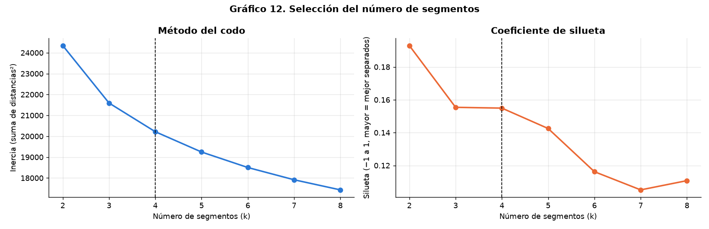

| k | Silueta | ARI vs Ward |
|---|---|---|
| 2 | 0,193 | — |
| 3 | 0,155 | 0,538 |
| **4** | **0,155** | **0,632** |
| 5 | 0,143 | 0,584 |

**Por qué k = 4:**
- k = 2 tiene la mayor silueta, pero solo separa grupos con 20,9% y 30,2% de churn, lo que sirve poco para diseñar campañas.
- k = 4 tiene la misma silueta que k = 3, es el **más estable** (dos algoritmos distintos encuentran casi los mismos grupos) y desde ahí la inercia baja menos de 1.000 por cada segmento adicional.
- La silueta de 0,155 indica que los segmentos se solapan, algo esperable con datos mayormente binarios. Por eso se usan como **perfiles** y no como reglas exactas.

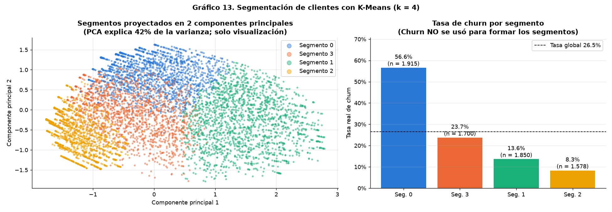

| Segmento | Perfil | Clientes | Churn | % del churn total | Ingreso mensual en riesgo | Acción propuesta |
|---|---|---|---|---|---|---|
| **0 — Nuevos en fibra sin contrato** | 13 meses, USD 84; 95,4% mes a mes; 95,7% fibra; 66,1% cheque electrónico; 12,2% con seguridad y soporte | 1.915 | **56,6%** | **57,9%** | USD 91.316 | **Prioridad 1:** migrar a contrato anual con descuento, incluir seguridad y soporte por algunos meses, incentivar el pago automático y un *onboarding* en los primeros meses |
| **3 — DSL intermedio** | 19 meses, USD 52; 65,1% mes a mes; clientes DSL; 42,8% con seguridad | 1.700 | 23,7% | 21,6% | USD 19.389 | **Prioridad 2:** paquetes de servicios de protección y paso a contrato anual |
| **1 — Leales premium** | 63 meses, USD 95; 47,8% con contrato de dos años; muchos servicios | 1.850 | 13,6% | 13,5% | USD 25.295 | Fidelización y renovación anticipada, sin descuentos masivos; vigilar a quienes el modelo marque como riesgo |
| **2 — Solo telefonía** | 96,7% sin internet; USD 20; 24 meses | 1.578 | 8,3% | 7,0% | USD 3.131 | Sin campaña de retención; oportunidad de vender internet |

El riesgo medio que asigna el modelo supervisado a cada segmento (0,770 · 0,406 · 0,262 · 0,169) sigue el mismo orden que el churn real. Los dos enfoques son **coherentes** entre sí. Las acciones son propuestas y deben validarse con un piloto.

### 6.5 Despliegue (propuesta)

1. **Puntaje mensual:** cargar `models/modelo_regresion_logistica.joblib` y `models/segmentacion_kmeans.joblib`, que incluyen el escalado, y calificar a los clientes activos con los datos limpios del notebook 1.
2. **Lista para el CRM:** clientes con probabilidad ≥ 0,50 (`models/config_modelo_final.json`), ordenados por riesgo y con su segmento y la oferta sugerida.
3. **Piloto A/B:** un grupo contactado y un grupo de control, para medir el éxito real y el ingreso retenido. También sirve para comparar la Regresión Logística con el Random Forest.
4. **Monitoreo:** recall y precisión mensuales con los abandonos reales, *drift* de las variables, reentrenamiento trimestral y auditoría de sesgo en cada reentrenamiento.

## 7. Evaluación de sesgos, ética y privacidad

**Privacidad**
- El dataset no tiene identificadores directos (nombre, RUT, dirección, teléfono). `customerID` es un código sin significado, y los datos son **ficticios**.
- En un caso real con clientes en Chile aplicaría la **Ley 19.628** sobre protección de la vida privada y la **Ley 21.719**, que la actualiza: usar solo los datos necesarios para la retención, informar la finalidad y resguardar los datos de facturación.

**Sesgo demográfico (medido)**
- **Género:**
  - No se asocia al churn (V = 0,009, p = 0,49) y su proporción es pareja en todos los deciles y segmentos. Se excluyó del modelo sin costo de desempeño.
  - El modelo marca como riesgo a 41,7% de los hombres y 41,6% de las mujeres, con recall de 0,796 y 0,782: **trato equivalente**.
- **Edad (`SeniorCitizen`):**
  - Se excluyó del modelo, pero el modelo igual marca como riesgo a 67,1% de los adultos mayores, contra 36,9% del resto, a través del tipo de plan: en el decil de mayor riesgo hay 31,2% de adultos mayores, contra 5,0% en el de menor riesgo.
  - Esto es coherente con su churn real (44,1% vs 23,3%), y las marcas son más acertadas para ese grupo (precisión 0,611 vs 0,466).
  - La brecha está en el recall: 0,929 para adultos mayores y 0,739 para el resto, así que el grupo con menos cobertura es el de los **no** adultos mayores.
  - Como la acción es **ofrecer un beneficio**, no perjudica al cliente. Con n = 222 adultos mayores en test, estas cifras deben monitorearse con más datos.

**Sesgo de representación**
- Los datos son de **una empresa ficticia de California**, de un solo trimestre y de un año no informado. No representan el mercado chileno: habría que reentrenar el modelo con datos locales antes de usarlo.

**Sesgo por desbalance**
- Se abordó con `class_weight="balanced"`, métricas centradas en la clase minoritaria y un umbral elegido según la meta de recall.

**Uso responsable**
- El modelo apoya la decisión de **ofrecer beneficios** de retención. No debe usarse para perjudicar a clientes, por ejemplo subiendo precios a quienes se predice que no se irán o negando servicios.

## 8. Conclusiones y recomendaciones

**Conclusiones**
- **Calidad de los datos:** es buena. El único problema fue `TotalCharges` (11 blancos), no hay valores atípicos y las columnas son 100% consistentes entre sí.
- **Factores de riesgo**, respaldados con métricas: contrato mes a mes, poca antigüedad, fibra óptica, cheque electrónico y no tener seguridad online ni soporte técnico. El cargo mensual sube el riesgo **solo** cuando va con contrato mes a mes.
- **Modelos supervisados:** la Regresión Logística y el Random Forest empatan técnicamente. Se eligió la **Regresión Logística** por ser interpretable: detecta el **78,9%** de los abandonos e identifica el **82,8% del ingreso en riesgo** contactando al 41,7% de la base.
- **Segmentación:** K-Means encontró 4 perfiles. El segmento **"nuevos en fibra sin contrato"** concentra el **57,9% de los abandonos**.
- **Ética:** excluir género y edad no costó desempeño. El modelo trata igual a hombres y mujeres.

**Recomendaciones de negocio**
1. **Pasar a contrato anual** a los clientes mes a mes de alto riesgo (OR 0,48 un año; 0,23 dos años).
2. **Actuar en los primeros meses:** en el primer decil de antigüedad (0–2 meses) abandona el 61%. Conviene un *onboarding* para clientes nuevos de fibra.
3. **Incluir seguridad online y soporte técnico** en las ofertas (OR 0,66 y 0,70) y **promover el pago automático** en lugar del cheque electrónico.
4. **Investigar la experiencia del servicio de fibra óptica** (OR 2,23), para saber si el problema es el precio o la calidad.
5. **Priorizar por decil de riesgo y personalizar la oferta por segmento**, validándolo con un **piloto A/B** antes de escalar.

**Limitaciones**
- Los datos son ficticios, de un solo trimestre y de otro país.
- No hay variables de calidad del servicio ni de contactos con atención al cliente.
- La tasa de éxito de las campañas es un supuesto.

## 9. Estructura del proyecto

```
Telco_EP2/
├── README.md                              Informe técnico (este documento)
├── requirements.txt                       Librerías necesarias para ejecutar el proyecto
├── .gitignore                             Archivos que no se versionan
├── data/
│   ├── Telco_Customer_Churn_Dataset.csv   Dataset original (IBM / Kaggle), 7.043 × 21
│   └── telco_churn_limpio.csv             Dataset limpio y codificado (lo genera el notebook 1)
├── notebooks/
│   ├── 01_EDA_Preparacion_Churn.ipynb     Origen de datos, calidad, EDA, preparación y ética
│   └── 02_Modelamiento_Churn.ipynb        Modelos supervisados, K-Means, evaluación, sesgo y despliegue
├── models/                                (lo genera el notebook 2)
│   ├── modelo_regresion_logistica.joblib  Modelo final (Pipeline con escalado incluido)
│   ├── modelo_random_forest.joblib        Modelo alternativo
│   ├── segmentacion_kmeans.joblib         Segmentación (Pipeline con escalado incluido)
│   ├── config_modelo_final.json           Modelo elegido, umbral y variables
│   ├── metricas_test.csv                  Métricas en el conjunto de prueba
│   └── perfil_segmentos.csv               Perfil de cada segmento
└── images/                                Gráficos generados por los notebooks
    ├── g1 … g5, forma_distribuciones, escalado_antes_despues   (notebook 1)
    └── g6 … g13                                                 (notebook 2)
```

## 10. Cómo reproducir el proyecto

Requisitos: Python 3.11 o superior.

```bash
# 1. Clonar el repositorio y entrar a la carpeta
git clone https://github.com/Abraham1439/Telco_EP2
cd Telco_EP2

# 2. (Recomendado) crear un entorno virtual
python -m venv .venv
source .venv/bin/activate          
En Windows: .venv\Scripts\activate

# 3. Instalar dependencias
pip install -r requirements.txt

# 4. Ejecutar los notebooks EN ORDEN (el 2 usa el archivo que genera el 1)
cd notebooks
jupyter notebook
#   abrir 01_EDA_Preparacion_Churn.ipynb  -> Kernel > Restart & Run All
#   abrir 02_Modelamiento_Churn.ipynb     -> Kernel > Restart & Run All
```

Para ejecutar los dos notebooks sin abrir Jupyter:

```bash
cd notebooks
jupyter nbconvert --to notebook --execute --inplace 01_EDA_Preparacion_Churn.ipynb
jupyter nbconvert --to notebook --execute --inplace 02_Modelamiento_Churn.ipynb
```

- Los notebooks usan rutas relativas (`../data`, `../images`, `../models`), así que deben ejecutarse desde la carpeta `notebooks/`.
- Todos los procesos aleatorios usan la semilla `RANDOM_STATE = 42`.
- El notebook 2 tarda unos 4 minutos por la búsqueda de hiperparámetros del Random Forest.
- Los resultados de este informe se obtuvieron con Python 3.13, pandas 3.0.5, NumPy 2.5.3, scikit-learn 1.9.1, SciPy 1.18.1 y matplotlib 3.11.2. Se verificó que con las versiones mínimas de `requirements.txt` los resultados son idénticos.
- `scikit-learn` está fijado en 1.9.1 porque con otra versión el Random Forest puede dar resultados levemente distintos. La Regresión Logística, el umbral y los segmentos no cambian.

## 11. Referencias

- IBM Samples Team (2019). *Telco customer churn (11.1.3+)*. IBM Community, Cognos Analytics. https://community.ibm.com/community/user/businessanalytics/blogs/steven-macko/2019/07/11/telco-customer-churn-1113
- BlastChar. *Telco Customer Churn* [dataset]. Kaggle. https://www.kaggle.com/datasets/blastchar/telco-customer-churn
- Zhu, Z. (2023). Customer Churn Prediction Based on Big Data and Machine Learning Approaches. *Proceedings of ICFIED 2023*, AEBMR vol. 237, pp. 4–15. Atlantis Press. https://www.atlantis-press.com/article/125986801.pdf
- Aryani, L. D. y Pratama, H. P. (2026). Classification of Telecommunication Customer Churn Using Logistic Regression and Support Vector Machine. *JSI Universitas Suryadarma*, 13(2), 272–280. https://journal.universitassuryadarma.ac.id/index.php/jsi/article/view/2069
- Wanda, R. K. (2024). *A Customer churn prediction and corrective action suggestion model for the telecommunications industry using predictive analytics* (tesis MSc). Strathmore University. https://su-plus.strathmore.edu/items/e0b0fada-f53a-4dc2-ae95-218dc83525a1
- Chapman, P. et al. (2000). *CRISP-DM 1.0: Step-by-step data mining guide*. SPSS.
- Ley N° 19.628 sobre Protección de la Vida Privada (Chile) y Ley N° 21.719 que la modifica.
